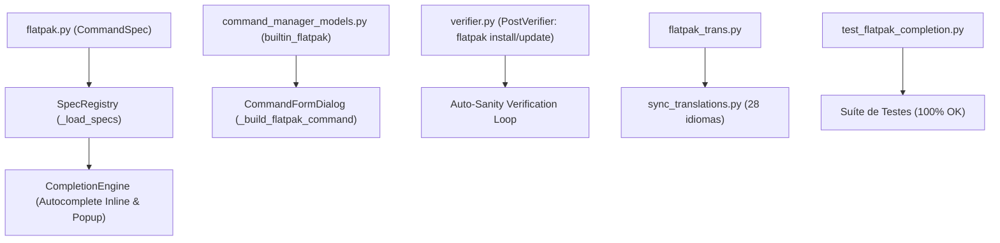

# 📦 Plano de Implementação: Autocomplete & Gerenciador de Pacotes Flatpak no OnyxSH

> **Documento de Arquitetura e Engenharia de Implementação**  
> **Componente:** `src/onyxsh/terminal/completion/specs/flatpak.py`  
> **Status:** Concluído e Validado (Todas as Fases 1 a 5 Implementadas com 100% de Testes - 650 Testes Passando)  
> **Módulos Afetados:** `src/onyxsh/terminal/completion/`, `src/onyxsh/data/`, `src/onyxsh/ui/dialogs/`, `src/onyxsh/agent/`, `scripts/translations/`, `tests/`

---

## 1. 🔍 Diagnóstico e Análise do Cenário Atual

A análise minuciosa da base de código do OnyxSH revelou:
- O sistema de autocomplete conta com especificações para **APT** (`apt`, `apt-get`), **DNF** (`dnf`, `yum`), **Pacman** (`pacman`), **Docker** (`docker`), **Git** (`git`), **Systemd** (`systemctl`, `journalctl`) e utilitários DevOps/Linux em `src/onyxsh/terminal/completion/specs/`.
- **Inexistência de especificação para o Flatpak**: Não há `flatpak.py`, nem registro do comando `flatpak` no [SpecRegistry](src/onyxsh/terminal/completion/specs/registry.py).
- No **Command Manager** ([command_manager_models.py](src/onyxsh/data/command_manager_models.py)), existem botões integrados para `builtin_apt`, `builtin_dnf` e `builtin_pacman`, mas **não há `builtin_flatpak`**.
- No **PostVerifier** ([verifier.py](src/onyxsh/agent/verifier.py)), comandos como `flatpak install` e `flatpak update` não contam com verificação automática de sanidade pós-execução.
- Considerando que o próprio OnyxSH é empacotado e distribuído oficialmente como Flatpak (`io.github.vagnarok.OnyxSH`), fornecer suporte nativo de autocomplete e gerenciamento para Flatpak é um diferencial indispensável de usabilidade.

---

## 2. 🎯 Escopo da Funcionalidade

A implementação contemplará todos os subcomandos, opções e fluxos comuns do utilitário `flatpak`:

### 2.1. Subcomandos de Ciclo de Vida de Aplicações
| Subcomando | Descrição | Opções Chave |
| :--- | :--- | :--- |
| `install` | Instalar aplicativo ou runtime de um repositório remoto ou arquivo | `-y`, `--assumeyes`, `--user`, `--system`, `--noninteractive`, `--reinstall`, `--from`, `--bundle`, `--arch=` |
| `uninstall` / `remove` | Desinstalar aplicativo ou runtime | `-y`, `--assumeyes`, `--user`, `--system`, `--unused`, `--delete-data`, `--all`, `--noninteractive` |
| `update` | Atualizar aplicativos e runtimes instalados | `-y`, `--assumeyes`, `--user`, `--system`, `--app`, `--runtime`, `--noninteractive` |
| `list` | Listar aplicativos e/ou runtimes instalados no host | `--app`, `--runtime`, `--all`, `-d`, `--show-details`, `--columns=`, `--user`, `--system` |
| `search` | Pesquisar aplicativos por termo nos repositórios remotos | `--user`, `--system`, `--columns=` |
| `info` | Exibir informações detalhadas e metadados de uma aplicação/runtime | `-m`, `--show-metadata`, `--show-permissions`, `--show-extensions`, `--user`, `--system` |
| `run` | Executar uma aplicação Flatpak em seu sandbox isolado | `--command=`, `--branch=`, `--arch=`, `--devel`, `-v`, `--verbose` |

### 2.2. Subcomandos de Repositórios Remotos (Remotes)
| Subcomando | Descrição | Opções Chave |
| :--- | :--- | :--- |
| `remotes` | Listar repositórios remotos configurados | `-d`, `--show-details`, `--show-disabled`, `--user`, `--system`, `--columns=` |
| `remote-add` | Adicionar novo repositório remoto (ex: Flathub) | `--if-not-exists`, `--from`, `--user`, `--system`, `--no-gpg-verify`, `--prio=` |
| `remote-delete` | Remover repositório remoto | `--force`, `--user`, `--system` |
| `remote-modify` | Alterar prioridade ou habilitar/desabilitar repositório remoto | `--enable`, `--disable`, `--prio=`, `--url=`, `--user`, `--system` |
| `remote-ls` | Listar aplicativos e runtimes disponíveis em um remoto | `--app`, `--runtime`, `--user`, `--system`, `--columns=` |

### 2.3. Subcomandos de Processos, Permissões e Manutenção
| Subcomando | Descrição | Opções Chave |
| :--- | :--- | :--- |
| `ps` | Listar instâncias ativas de aplicações Flatpak em execução | `--columns=`, `-v` |
| `kill` | Encerrar instância de aplicativo Flatpak em execução | `<instância ou PID>` |
| `override` | Gerenciar permissões e overrides de sandbox | `--filesystem=`, `--nofilesystem=`, `--device=`, `--share=`, `--reset`, `--show`, `--user`, `--system` |
| `permission-show` | Exibir tabela de permissões de portais de desktop | `<app-id>` |
| `permission-reset` | Restaurar permissões padrão de portais de desktop | `<app-id>` |
| `repair` | Verificar e reparar integridade de instalações e repositórios OSTree | `--user`, `--system`, `--dry-run`, `-v` |
| `history` | Consultar histórico de transações de instalação e atualização | `--user`, `--system`, `--columns=` |
| `config` | Consultar ou alterar parâmetros de configuração do Flatpak | `--list`, `--set`, `--unset`, `--user`, `--system` |

### 2.4. Opções Globais
- `-y`, `--assumeyes`: Responde automaticamente 'sim' a prompts interativos.
- `--noninteractive`: Não solicita confirmações e simplifica saídas.
- `--user`: Opera sobre a instalação local do usuário (`~/.local/share/flatpak`).
- `--system`: Opera sobre a instalação global do sistema (`/var/lib/flatpak`).
- `-v`, `--verbose`: Emite informações detalhadas de diagnóstico.
- `--arch=`: Define a arquitetura do pacote (ex: `x86_64`, `aarch64`).

---

## 3. 🏗️ Arquitetura e Fases de Implementação



---

### 🚀 Fase 1: Especificação Declarativa de Autocomplete
- **Arquivo Novo:** `src/onyxsh/terminal/completion/specs/flatpak.py`
  - Criar função `get_flatpak_spec() -> CommandSpec` utilizando `OptionSpec` e `SubcommandSpec`.
  - Definir todos os 18 subcomandos listados na seção 2 com descrições internacionalizáveis `_()`, flags e exemplos práticos de uso.
- **Registro no Registry:** [registry.py](src/onyxsh/terminal/completion/specs/registry.py)
  - Importar `get_flatpak_spec` e adicionar à lista de inicialização de `SpecRegistry._load_specs()`.

---

### 🎛️ Fase 2: Integração com o Command Manager (UI Gráfica)
- **Modelos:** [command_manager_models.py](src/onyxsh/data/command_manager_models.py)
  - Adicionar o botão embutido `builtin_flatpak` na lista `get_builtin_commands()` (categoria `System`, ícone `system-software-install-symbolic`).
  - Campo Dropdown `action`:
    - `install`, `update`, `uninstall`, `list --app`, `search`, `run`, `repair`, `remotes`.
  - Campo Texto `app_id`: Nome da aplicação ou ID reverso (ex: `org.gnome.Calculator`, `io.github.vagnarok.OnyxSH`).
  - Campo Checkbox `user_scope`: Alternar entre `--user` e instalação do sistema.
- **Handler no Diálogo:** [command_manager_dialog.py](src/onyxsh/ui/dialogs/command_manager_dialog.py)
  - Implementar método `_build_flatpak_command(self, values: Dict[str, Any]) -> str` para compor o comando com suporte limpo a ações que não exigem AppID (`update`, `list`, `repair`, `remotes`).

---

### 🛡️ Fase 3: Validação Pós-Execução no Agente IA (PostVerifier)
- **Arquivo:** [verifier.py](src/onyxsh/agent/verifier.py)
  - Adicionar regra no método `infer_checks()`:
    - Ao detectar `flatpak install [args] <app_id>`: propor verificação `flatpak info <app_id>` com diagnóstico `flatpak list --app`.
    - Ao detectar `flatpak uninstall [args] <app_id>`: verificar com `test -z "$(flatpak list --app | grep <app_id>)"`.
    - Ao detectar `flatpak update`: propor `flatpak list --updates`.

---

### 🌐 Fase 4: Internacionalização em 28 Idiomas
- **Arquivo Novo:** `scripts/translations/flatpak_trans.py`
  - Dicionário com termos e descrições do Flatpak em Português, Espanhol, Francês, Alemão, Italiano, Russo, Japonês, Chinês e demais línguas.
- **Sincronização:** Integrar no `scripts/sync_translations.py` e compilar os binários `.mo`.

---

### 🧪 Fase 5: Testes Unitários Automatizados
- **Arquivo Novo:** `tests/test_flatpak_completion.py`
  - Testar registro do `flatpak` no `SpecRegistry`.
  - Testar autocompletar de subcomandos primários (`flatpak ins` -> `install`).
  - Testar autocompletar de flags (`flatpak install --ass` -> `--assumeyes`).
  - Testar resolução contextual no `CompletionEngine`.
  - Testar botão `builtin_flatpak` e geração de comando no `CommandManager`.
  - Testar regras de inferência no `PostVerifier`.
- **Validação Global:** Executar suite completa garantindo 100% de sucesso:
  ```bash
  PYTHONPATH=src python3 -m unittest discover -s tests
  ```

---

## 4. 📅 Estimativa de Esforço e Impacto

| Etapa | Complexidade | Esforço Estimado | Risco |
| :--- | :---: | :---: | :---: |
| **Fase 1: Spec Declarativo** | Baixa | ~1 hora | Mínimo |
| **Fase 2: Command Manager UI** | Baixa | ~45 min | Mínimo |
| **Fase 3: PostVerifier** | Média | ~45 min | Baixo |
| **Fase 4: Internacionalização** | Baixa | ~30 min | Mínimo |
| **Fase 5: Testes Unitários** | Baixa/Média | ~45 min | Mínimo |
| **Total** | — | **~3.5 horas** | **Baixíssimo** |

---

*Plano arquitetado de acordo com as diretrizes e padrões de desenvolvimento do OnyxSH.*
