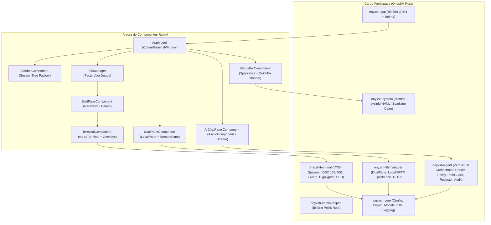

# 🦀 Plano Diretor e Cronograma de Migração Integral do OnyxSH para Rust + Relm4

> **Documento Técnico de Engenharia — Reescrita Nativa (`branch: rewrite-rust`)**  
> **App ID:** `io.github.vagnarok.OnyxSH`  
> **Arquitetura Alvo:** Rust Edition 2024 (1.85+) + Relm4 0.9+ (`gtk4-rs` + `libadwaita-rs`) + `vte4` + Tokio Async Runtime  
> **Objetivo Estratégico:** Transformar o OnyxSH em um dos emuladores de terminal nativos mais rápidos, seguros em memória e econômicos em recursos do ecossistema Linux/GNOME, competindo diretamente em engenharia com **Ptyxis** (C/GTK4) e **COSMIC Terminal** (Rust).

---

## 📑 Sumário

1. [Visão Geral da Estratégia de Migração](#1-visão-geral-da-estratégia-de-migração)
2. [Arquitetura Alvo em Rust com Relm4](#2-arquitetura-alvo-em-rust-com-relm4)
3. [Mapeamento Completo de Dependências (Python ➔ Crates Rust)](#3-mapeamento-completo-de-dependências-python--crates-rust)
4. [Estrutura de Workspace Cargo (`rewrite-rust`)](#4-estrutura-de-workspace-cargo-rewrite-rust)
5. [Cronograma Geral de Execução (Fases 0 a 6)](#5-cronograma-geral-de-execução-fases-0-a-6)
6. [Guia Passo a Passo de Migração por Subsistema e Arquivo](#6-guia-passo-a-passo-de-migração-por-subsistema-e-arquivo)
   - [Fase 0: Fundação, Build System, Recursos e Core](#fase-0-fundação-build-system-recursos-e-core)
   - [Fase 1: Settings, Persistência, Criptografia e Sessões](#fase-1-settings-persistência-criptografia-e-sessões)
   - [Fase 2: Motor de Terminal VTE4, PTY, Host-Spawn e Abas/Splits](#fase-2-motor-de-terminal-vte4-pty-host-spawn-e-abassplits)
   - [Fase 3: Realce Sintático, Rastreamento Semântico (OSC 133/7/52), Guard e SSH](#fase-3-realce-sintático-rastreamento-semântico-osc-133752-guard-e-ssh)
   - [Fase 4: Gerenciador de Arquivos Dual-Pane, SFTP, Quick Look e TFTP](#fase-4-gerenciador-de-arquivos-dual-pane-sftp-quick-look-e-tftp)
   - [Fase 5: Motor de IA e Agente Autônomo Zero-Trust](#fase-5-motor-de-ia-e-agente-autônomo-zero-trust)
   - [Fase 6: Polkit Admin Helper, Telemetria Cairo, Diálogos Finais e Flatpak](#fase-6-polkit-admin-helper-telemetria-cairo-diálogos-finais-e-flatpak)
7. [Padrões de Tradução de Código (Python/PyGObject ➔ Rust/Relm4)](#7-padrões-de-tradução-de-código-pythonpygobject--rustrelm4)
8. [Estratégia de Testes, Benchmarks e Critérios de Aceite](#8-estratégia-de-testes-benchmarks-e-critérios-de-aceite)

---

## 1. Visão Geral da Estratégia de Migração

### Por que Relm4 + Rust?
Na implementação atual em Python + PyGObject, o OnyxSH precisa contornar limitações estruturais da linguagem:
- **Overhead de Memória e Inicialização:** O interpretador Python + bindings dinâmicos GObject Introspection consomem ~65–110 MB de RSS base. Em Rust + Relm4 compilado nativamente com LTO, o consumo inicial cai para **~18–28 MB de RSS** e o tempo de *cold start* cai para **< 50 ms**.
- **Concorrência Real sem GIL:** No Python, o `AsyncTaskManager` usa múltiplos `ThreadPoolExecutor` e `GLib.idle_add` manuais. No **Relm4**, cada componente possui canais tipados (`ComponentSender`), suporte nativo a comandos assíncronos no runtime **Tokio** (`sender.oneshot_command(...)` / `AsyncComponent`) e `Worker` dedicados fora da thread principal da GUI, eliminando *data races* em tempo de compilação.
- **Gerenciamento de Estado Previsível (Elm-like Architecture):** Em vez de dezenas de callbacks mutando atributos espalhados em `window.py` e `manager.py`, o Relm4 impõe um fluxo unidirecional claro:
  `Evento GTK / Tarefa Async` ➔ `Input Enum` ➔ `update(&mut self, msg, sender)` ➔ ` #[watch] View Macro` ➔ `Output Enum`.

### Estratégia de Branching
1. Criar a branch dedicada a partir da `develop`:
   ```bash
   git checkout -b rewrite-rust
   ```
2. Adotar um **Cargo Workspace** multi-crate onde a lógica de domínio (`onyxsh-core`, `onyxsh-terminal`, `onyxsh-agent`, `onyxsh-vfs`, `onyxsh-admin`) é desacoplada da camada visual (`onyxsh-ui` / binário principal). Isso permite testar 100% das regras de negócio com `cargo test` sem exigir servidor gráfico X11/Wayland ativo.

---

## 2. Arquitetura Alvo em Rust com Relm4



---

## 3. Mapeamento Completo de Dependências (Python ➔ Crates Rust)

| Subsistema Atual (Python) | Crate Rust Equivalente | Justificativa Técnica |
|---|---|---|
| `gi.repository.Gtk`, `Adw`, `Gio`, `GLib` | `relm4`, `gtk4`, `libadwaita` (`adw`) | Bindings oficiais `gtk-rs` com macros reativas `relm4::view!` |
| `gi.repository.Vte` (`vte-2.91-gtk4`) | `vte4` | Bindings Rust para `libvte-2.91-gtk4` |
| `cairo` (`pycairo`) | `cairo-rs` (`gtk4::cairo`) | Renderização vetorial nativa das Sparklines e previews |
| `AsyncTaskManager` (`ThreadPoolExecutor`) | `tokio` (multi-thread runtime) + `rayon` | `tokio` para I/O assíncrono (SSH, LLM, FS) e `rayon` para CPU-bound |
| `core/signals.py` | `relm4::MessageBroker` / `tokio::sync::broadcast` | Mensageria tipada em tempo de compilação sem vazamento de listeners |
| `json` / `dataclasses` | `serde`, `serde_json` | Serialização zero-copy de altíssima performance e tipagem forte |
| `regex` (PCRE2) / `re` | `regex` / `fancy-regex` / `aho-corasick` | Autômatos finitos determinísticos (DFA) em tempo linear garantido ($O(n)$) |
| `Pygments` | `syntect` | Motor de realce sintático em Rust baseado em gramáticas Sublime/TextMate |
| `SecretService` / `pycryptodomex` | `oo7` (libsecret DBus) + `aes-gcm` + `argon2` + `zeroize` | `oo7` é o padrão GNOME Rust para Keyring/Flatpak Portal; `zeroize` limpa segredos da RAM |
| `requests` (Provedores LLM) | `reqwest` (com `rustls-tls` e `stream`) + `eventsource-stream` | Streaming SSE assíncrono nativo sem bloqueio de threads |
| `psutil` | `sysinfo` + `nvml-wrapper` | Coleta nativa de CPU, RAM, Rede e VRAM NVIDIA/AMD via sysfs |
| `shlex` / `subprocess` / `pty` | `shlex`, `nix` (`pty`, `signal`, `unistd`), `tokio::process` | Controle direto de descritores PTY, sinais POSIX e `host-spawn` |
| Operações SFTP / Túneis SSH | `russh` + `russh-sftp` (ou `openssh` / `gio::File`) | Cliente SSH/SFTP assíncrono puro em Rust ou multiplexação ControlMaster |
| `py7zr` / `tarfile` / `zipfile` | `sevenz-rust`, `tar`, `flate2`, `zip` | Compressão e backups nativos sem dependências externas |
| `gettext` (`translation_utils.py`) | `gettext-rs` | Compatibilidade direta com os 28 arquivos `.po`/`.mo` já existentes no projeto |
| `utils/logger.py` | `tracing`, `tracing-subscriber`, `tracing-appender` | Logging estruturado, spans assíncronos e rotação de arquivos não-bloqueante |

---

## 4. Estrutura de Workspace Cargo (`rewrite-rust`)

Ao iniciar a branch `rewrite-rust`, o repositório será organizado como um **Cargo Workspace** limpo integrado ao **Meson** (padrão oficial GNOME/Flatpak para empacotar recursos `.gresource`, ícones, arquivos `.desktop`, `.policy` e traduções `gettext`):

```text
OnyxSH/
├── Cargo.toml                          # Definição do Workspace e dependências compartilhadas
├── meson.build                         # Build system para instalar ícones, .desktop, Polkit e .mo
├── data/                               # Assets desktop, ícones SVG, GResource XML, schemas
├── po/                                 # Traduções Gettext existentes (28 idiomas preservados)
├── crates/
│   ├── onyxsh-core/                    # Configurações, modelos base, criptografia, paths, i18n
│   │   ├── Cargo.toml
│   │   └── src/
│   │       ├── lib.rs
│   │       ├── config.rs               # Port de settings/config.py + settings/manager.rs
│   │       ├── crypto.rs               # Port de utils/crypto.py (oo7 + AES-GCM + zeroize)
│   │       ├── platform.rs             # Port de utils/platform.py (detecção Flatpak, distros)
│   │       ├── security.rs             # Port de utils/security.py + sessions/validation.py
│   │       ├── sessions.rs             # Port de sessions/models.py, storage.py, operations.py
│   │       ├── snippets.rs             # Port de data/snippet_resolver.py + command_history
│   │       ├── ssh_config.rs           # Port de utils/ssh_config_parser.py
│   │       └── backup.rs               # Port de utils/backup.py + checksum_utils.py
│   │
│   ├── onyxsh-terminal/                # Motor VTE4, PTY, Highlighter, OSC, Guard, Autocomplete
│   │   ├── Cargo.toml
│   │   └── src/
│   │       ├── lib.rs
│   │       ├── spawner.rs              # Port de terminal/spawner.py (PTY + host-spawn Flatpak)
│   │       ├── semantic_tracker.rs     # Port de terminal/semantic_tracker.py (OSC 133)
│   │       ├── osc7_tracker.rs         # Port de utils/osc7.py + osc7_tracker.py
│   │       ├── osc52_bridge.rs         # Port de terminal/osc52_bridge.py
│   │       ├── production_guard.rs     # Port de terminal/production_guard.py
│   │       ├── highlighter/            # Port de terminal/highlighter/* + settings/highlights.py
│   │       ├── completion/             # Port de terminal/completion/* (engine + specs)
│   │       ├── ssh_health.rs           # Port de terminal/ssh_health_monitor.py
│   │       ├── tunnel_manager.rs       # Port de terminal/tunnel_manager.py
│   │       ├── exporter.rs             # Port de terminal/exporter.py (HTML, TXT, SVG)
│   │       ├── runbook.rs              # Port de terminal/runbook.py
│   │       └── git_assistant.rs        # Port de terminal/git_assistant.py + utils/git_utils.py
│   │
│   ├── onyxsh-filemanager/             # VFS Local/SFTP, Dual-Pane Models, Quick Look, TFTP
│   │   ├── Cargo.toml
│   │   └── src/
│   │       ├── lib.rs
│   │       ├── models.rs               # Port de filemanager/models.py
│   │       ├── operations.rs           # Port de filemanager/operations.py (Local + SFTP async)
│   │       ├── transfer_manager.rs     # Port de filemanager/transfer_manager.py
│   │       └── tftp_server.rs          # Port de filemanager/tftp_server.py (UDP Tokio)
│   │
│   ├── onyxsh-agent/                   # Motor de IA Zero-Trust, Router, Provedores, Auditoria
│   │   ├── Cargo.toml
│   │   └── src/
│   │       ├── lib.rs
│   │       ├── models.rs               # Port de agent/models.py (ActionPlan, RiskLevel)
│   │       ├── orchestrator.rs         # Port de agent/orchestrator.py
│   │       ├── router.rs               # Port de agent/router.py (SmartRouter + Classifier)
│   │       ├── planner.rs              # Port de agent/planner.py
│   │       ├── policy_engine.rs        # Port de agent/policy_engine.py
│   │       ├── path_guard.rs           # Port de agent/path_guard.py
│   │       ├── redactor.rs             # Port de agent/redactor.py
│   │       ├── verifier.rs             # Port de agent/verifier.py
│   │       ├── audit.rs                # Port de agent/audit.py (JSONL + Atomic Rollback)
│   │       ├── error_matcher.rs        # Port de agent/error_matcher.py
│   │       ├── context_manager.rs      # Port de agent/context_manager.py
│   │       ├── tools/                  # Port de fs_tools.py, shell_tools.py, admin_tools.py
│   │       └── providers/              # Port de gemini.py, groq.py, ollama.py, openrouter.py
│   │
│   ├── onyxsh-system/                  # Coleta de métricas de hardware e diagnósticos
│   │   ├── Cargo.toml
│   │   └── src/
│   │       ├── lib.rs
│   │       ├── metrics.rs              # Port de system/metrics.py
│   │       └── diagnostics.rs          # Port de utils/diagnostics.py
│   │
│   ├── onyxsh-admin-helper/            # Binário isolado Polkit (pkexec)
│   │   ├── Cargo.toml
│   │   └── src/
│   │       └── main.rs                 # Port de admin/helper.py
│   │
│   └── onyxsh-app/                     # Aplicação Relm4 GTK4/Libadwaita (UI & Orquestração)
│       ├── Cargo.toml
│       └── src/
│           ├── main.rs                 # Port de __main__.py + app.py
│           ├── window.rs               # Port de window.py + ui/window_ui.py
│           ├── theme_engine.rs         # Port de utils/theme_engine.py + ui/colors.py
│           ├── actions.rs              # Port de ui/actions.py
│           ├── components/             # Componentes Relm4 (Tabs, Splits, Sidebar, DualPane, AI)
│           └── dialogs/                # Todos os 22 diálogos modais em Relm4
```

---

## 5. Cronograma Geral de Execução (Fases 0 a 6)

O projeto está estruturado em **7 fases sequenciais incrementais** (estimativa total de **16 a 20 semanas** para 1–2 engenheiros trabalhando em ritmo sustentável, com entregáveis compiláveis e testáveis ao fim de cada fase):

| Fase | Escopo Principal | Duração Estimada | Marco de Entrega (Milestone) |
|---|---|---|---|
| **Fase 0** | Setup da branch `rewrite-rust`, Workspace Cargo, Meson, GResources, Logging (`tracing`), I18n (`gettext-rs`) e `onyxsh-core` básico | Semanas 1–2 | Binário `onyxsh` abre janela `Adw::ApplicationWindow` vazia com suporte a temas, CLI single-instance e traduções carregadas |
| **Fase 1** | Configurações Reativas, Criptografia (`oo7` + AES-GCM), Modelos de Sessões, Árvore de Sessões e Estado de Janela | Semanas 3–4 | Barra lateral funcional lendo/salvando `~/.config/onyxsh/sessions.json` e `settings.json` com 100% de retrocompatibilidade |
| **Fase 2** | Emulador de Terminal (`vte4`), Spawner PTY + Bypass Flatpak (`host-spawn`), Abas, Divisões Recursivas (Splits) e Busca no Terminal | Semanas 5–8 | Emulador de terminal completo e ultrarrápido com múltiplas abas, splits, busca regex, zoom e restauração de sessão |
| **Fase 3** | Realce Sintático (`syntect`/`regex`), OSC 133/7/52, `ProductionGuard`, Autocomplete Popover, Túneis e Monitor SSH | Semanas 9–11 | Paridade total de recursos avançados de terminal, segurança de produção e conectividade SSH resiliente |
| **Fase 4** | Gerenciador de Arquivos Dual-Pane (Local + SFTP), Fila de Transferências, *Quick Look* e Servidor TFTP | Semanas 12–14 | Gerenciador Dual-Pane operando com `gio::ListStore` / `FactoryVecDeque`, preview instantâneo no `Espaço` e servidor TFTP UDP |
| **Fase 5** | Motor de IA Chat Assistant + Agente Autônomo Zero-Trust (`SmartRouter`, `Redactor`, `PolicyEngine`, `PathGuard`, `AuditLogger`, Provedores) | Semanas 15–17 | Painel lateral de IA com streaming SSE, cartões de aprovação de planos, ciclo de vida de VRAM Ollama e rollback de auditoria |
| **Fase 6** | Binário `onyxsh-admin-helper` (Polkit), Dashboard Cairo Sparklines, Diálogos Finais, Manifesto Flatpak `cargo-sources` e Homologação | Semanas 18–20 | Pacote Flatpak nativo compilado em Rust, zero dependências Python, suíte de testes e benchmarks validados |

---

## 6. Guia Passo a Passo de Migração por Subsistema e Arquivo

Abaixo estão todos os passos detalhados para migrar cada módulo e arquivo do código Python atual (`src/onyxsh/`) para a nova arquitetura Rust.

---

### Fase 0: Fundação, Build System, Recursos e Core

#### Objetivos
Configurar o workspace Rust, empacotamento de recursos estáticos (CSS, ícones SVG, políticas JSON) via `glib-build-tools` (`GResource`) e migrar a infraestrutura base.

#### Passo a Passo Técnico

1. **Inicialização da Branch e Workspace (`Cargo.toml` raiz):**
   - Criar a branch `git checkout -b rewrite-rust`.
   - Configurar `[workspace]` com `resolver = "2"` (ou `"3"` no Rust 2024) listando as 7 crates em `crates/*`.
   - Configurar perfis de compilação otimizados para binários enxutos e rápidos:
     ```toml
     [profile.release]
     lto = "thin"
     codegen-units = 1
     strip = "symbols"
     opt-level = 3
     ```

2. **Empacotamento de Assets (`src/onyxsh/icons/*` e `src/onyxsh/data/styles/*`):**
   - Criar `data/resources.gresource.xml` referenciando todos os 38 ícones simbólicos SVG de `src/onyxsh/icons/` e os estilos CSS de `src/onyxsh/data/styles/`.
   - No `build.rs` da crate `onyxsh-app`, usar `glib_build_tools::compile_resources` para embutir os assets diretamente no binário executável (eliminando I/O de disco no startup).

3. **Migração do Sistema de Logs (`src/onyxsh/utils/logger.py` ➔ `onyxsh-core/src/logger.rs`):**
   - Substituir o `LoggerManager` Python por `tracing` + `tracing-subscriber` + `tracing-appender::rolling`.
   - Configurar filtro dinâmico via `EnvFilter` e escrita não-bloqueante (`non_blocking` worker guard) em `~/.local/share/onyxsh/logs/onyxsh.log` com rotação atômica.

4. **Migração do Sistema de Traduções (`src/onyxsh/utils/translation_utils.py` ➔ `onyxsh-core/src/i18n.rs`):**
   - Integrar `gettextrs::bindtextdomain("onyxsh", locale_dir)` e `gettextrs::textdomain("onyxsh")`.
   - Expor macro `i18n!("Texto")` ou função `tr("Texto")` para reutilizar imediatamente todos os 28 catálogos de tradução existentes no projeto.

5. **Migração de Detecção de Plataforma (`src/onyxsh/utils/platform.py` ➔ `onyxsh-core/src/platform.rs`):**
   - Implementar `is_flatpak_sandbox() -> bool` usando `std::sync::OnceLock` checando `Path::new("/.flatpak-info").exists()`.
   - Implementar detecção de distribuição Linux lendo `/etc/os-release` (mapeando gerenciadores de pacote `apt`, `dnf`, `pacman`, `zypper`, `apk`).
   - Implementar `CommandBuilder` que prefixa automaticamente `host-spawn` ou `flatpak-spawn --host` quando `is_flatpak_sandbox()` for `true`.

6. **Migração do Ciclo de Vida do App (`src/onyxsh/__main__.py` + `src/onyxsh/app.py` ➔ `onyxsh-app/src/main.rs`):**
   - Configurar `RelmApp::new("io.github.vagnarok.OnyxSH")`.
   - Configurar flags `gio::ApplicationFlags::HANDLES_COMMAND_LINE` para suportar argumentos CLI (`--tab`, `--working-directory`, `--execute`, `ssh://...`) e enviar mensagens para a instância já aberta via DBus.

---

### Fase 1: Settings, Persistência, Criptografia e Sessões

#### Objetivos
Garantir **100% de compatibilidade com os arquivos de configuração do usuário** já salvos pelas versões Python (`~/.config/onyxsh/settings.json` e `~/.config/onyxsh/sessions.json`) e portar a árvore lateral de sessões.

#### Passo a Passo Técnico

1. **Configurações Reativas (`src/onyxsh/settings/config.py` + `manager.py` ➔ `onyxsh-core/src/config.rs`):**
   - Modelar a struct `AppSettings` com `#[derive(Serialize, Deserialize, Clone, Debug)]` e `#[serde(default)]` para que chaves novas ou ausentes no `settings.json` façam fallback automático sem falhar o parse.
   - Migrar a lógica de reparo de atalhos duplicados/obsoletos (`test_settings_shortcuts_repair.py`) para um método `AppSettings::sanitize_shortcuts(&mut self)`.
   - Implementar persistência atômica: serializar para `.settings.json.tmp`, chamar `file.sync_all()`, e executar `std::fs::rename` para `settings.json`.
   - No Relm4, transmitir mudanças de configuração para todos os componentes ativos via `relm4::SharedState<AppSettings>` ou `relm4::MessageBroker<SettingsChangedMsg>`.

2. **Criptografia e SecretService (`src/onyxsh/utils/crypto.py` ➔ `onyxsh-core/src/crypto.rs`):**
   - Integrar a crate `oo7` (`oo7::Keyring::new().await`) para ler e gravar senhas de sessões SSH e chaves de API de LLMs diretamente no GNOME Keyring / portal `org.freedesktop.secrets`.
   - Implementar o fallback de criptografia simétrica compatível usando as crates `aes-gcm` e `pbkdf2`/`sha2`.
   - Envolver strings de senhas e API keys em `zeroize::Zeroizing<String>` para que sejam sobrescritas com zeros na memória RAM assim que saírem de escopo.

3. **Modelos, Validação e Armazenamento de Sessões (`src/onyxsh/sessions/*` ➔ `onyxsh-core/src/sessions.rs`):**
   - Portar `SessionItem`, `FolderItem` e `LayoutItem` (`sessions/models.py`) para structs Rust com `serde`. Manter todos os campos JSON idênticos (`name`, `host`, `port`, `user`, `auth_type`, `key_path`, `is_production`, `tab_color`, `post_login_command`, `x11_forwarding`, `tunnels`, `folder_path`).
   - Portar `sessions/validation.py` e `utils/security.py`: validar IPs (`std::net::IpAddr`), hostnames RFC 1123, portas (`1..=65535`) e caminhos de chaves SSH.
   - Portar `utils/ssh_config_parser.py` para `onyxsh-core/src/ssh_config.rs` para importar hosts de `~/.ssh/config`.
   - Portar `utils/backup.py` e `utils/checksum_utils.py` usando `sevenz-rust` e `sha2`.

4. **Árvore de Sessões na UI (`src/onyxsh/sessions/tree.py` + `ui/sidebar_manager.py` ➔ `onyxsh-app/src/components/sidebar.rs`):**
   - Construir o `SidebarComponent` usando `gtk4::ListView` + `gtk4::TreeListModel` (ou `relm4::typed_view::tree`).
   - Implementar drag-and-drop de sessões entre pastas, filtro de busca instantânea na barra lateral e menu de contexto (Conectar, Editar, Duplicar, Exportar, Excluir).

5. **Estado da Janela (`src/onyxsh/state/window_state.py` ➔ `onyxsh-core/src/window_state.rs`):**
   - Serializar/deserializar a árvore de abas e splits abertos para restaurar sessões anteriores ao abrir o aplicativo.

---

### Fase 2: Motor de Terminal VTE4, PTY, Host-Spawn e Abas/Splits

#### Objetivos
Substituir o coração da aplicação (`terminal/manager.py`, `terminal/spawner.py`, `terminal/tabs.py`) por componentes nativos `vte4` e `Relm4`.

#### Passo a Passo Técnico

1. **Spawner Híbrido e ProcessTracker (`src/onyxsh/terminal/spawner.py` ➔ `onyxsh-terminal/src/spawner.rs`):**
   - Implementar alocação de PTY com `vte4::Pty::new_sync` / `spawn_async`.
   - **Modo Host Nativo:** Detectar shell padrão do usuário via `nix::unistd::User::from_uid(nix::unistd::getuid())` e iniciar no diretório de trabalho solicitado (`cwd`), injetando os scripts de integração de shell (hooks OSC 133 e OSC 7 para Bash, Zsh e Fish) via variáveis de ambiente (`ZDOTDIR` temporário / `--rcfile`).
   - **Modo Flatpak Sandbox (`host-spawn`):** Construir a linha de comando passando `--pty` e variáveis de ambiente sanitizadas para o binário `host-spawn` (ou portal `org.freedesktop.Flatpak.Development.HostCommand`), garantindo repasse de `SIGWINCH`, `SIGINT` e `SIGTSTP`.
   - **ProcessTracker:** Rastrear PIDs filhos ativos, inspecionar `/proc/<pid>/stat` e `/proc/<pid>/cmdline` (para saber se há um processo em foreground rodando no shell, substituindo `test_terminal_running_indicator.py`) e limpar diretórios temporários de integração no evento `child-exited`.

2. **Componente de Terminal (`src/onyxsh/terminal/manager.py` ➔ `onyxsh-app/src/components/terminal_pane.rs`):**
   - Criar `TerminalPaneComponent` encapsulando um `vte4::Terminal` dentro de um `gtk4::Overlay`.
   - Conectar controladores de eventos GTK4 (`gtk4::EventControllerKey`, `gtk4::GestureClick`, `gtk4::EventControllerScroll`).
   - Configurar hiperlinks clicáveis via `terminal.match_add_regex(...)` para URLs `https?://`, `file://` e caminhos de arquivos locais.
   - Implementar **Modo de Seleção via Teclado** e **Popover de Seleção** (`ui/widgets/selection_popover.py` — copiar, buscar na web, perguntar à IA, executar).

3. **Gerenciador de Abas e Splits Recursivos (`src/onyxsh/terminal/tabs.py` ➔ `onyxsh-app/src/components/tab_manager.rs`):**
   - Usar `adw::TabView` + `adw::TabBar` ou a barra de abas customizada do OnyxSH gerenciada por `FactoryVecDeque<TabItem>`.
   - Modelar divisões de tela (Splits Horizontais e Verticais) como uma árvore algébrica em Rust:
     ```rust
     pub enum SplitNode {
         Leaf(Controller<TerminalPaneComponent>),
         Paned {
             orientation: gtk4::Orientation,
             first: Box<SplitNode>,
             second: Box<SplitNode>,
             paned_widget: gtk4::Paned,
         },
     }
     ```
   - Implementar **Modo Broadcast** (enviar digitação simultaneamente para todos os painéis divididos da aba ou todas as abas).

4. **Busca no Terminal (`window.py` search logic ➔ `onyxsh-app/src/components/search_bar.rs`):**
   - Criar `TerminalSearchBarComponent` com debounce de 150ms via Tokio timer (`tokio::time::sleep`), suporte a Regex (`vte4::Regex::for_search`), Case-Sensitive, Whole-Word, `search_set_wrap_around(true)` e contador exato de ocorrências (`X de Y`).

---

### Fase 3: Realce Sintático, Rastreamento Semântico (OSC 133/7/52), Guard e SSH

#### Objetivos
Portar os diferenciais competitivos avançados do terminal do OnyxSH com performance de código compilado.

#### Passo a Passo Técnico

1. **Motor de Realce Sintático (`src/onyxsh/terminal/_highlighter_impl.py` + `terminal/highlighter/*` + `settings/highlights.py` ➔ `onyxsh-terminal/src/highlighter/`):**
   - **Vantagem crítica do Rust:** No Python, interceptar e aplicar regex ANSI na saída do PTY exige cuidado extremo para não causar latência em `cat` de arquivos grandes. Em Rust, usar `regex::bytes::RegexSet` compilado em DFA:
     - Avalia todas as 50+ regras de contexto (`src/onyxsh/data/highlights/*.json`) em **uma única passagem linear** sobre o buffer de bytes (`&[u8]`) sem sequer exigir conversão UTF-8 prévia.
   - Implementar `ShellInputHighlighter` para colorir comandos digitados pelo usuário em tempo real (comandos válidos vs inválidos no `$PATH`, flags, strings cotadas, pipes).

2. **Rastreadores OSC 133, OSC 7 e OSC 52 (`semantic_tracker.py`, `osc7_tracker.py`, `osc52_bridge.py`):**
   - **`semantic_tracker.rs` (OSC 133):** Manter um `VecDeque<CommandBlock>` limitado por terminal registrando a linha de início do prompt (`A`), início do comando (`B`), início do output (`C`) e código de saída (`D;exit_code`). Habilitar as ações `scroll_to_previous_prompt`, `scroll_to_next_prompt` e `copy_last_command_output`.
   - **`osc7_tracker.rs` (OSC 7):** Fazer parse de `file://hostname/path` com decodificação percent-encoding para atualizar o diretório atual da aba e sincronizar novas abas/splits.
   - **`osc52_bridge.rs` (OSC 52):** Decodificar payload Base64 com limite máximo de bytes configurável (proteção contra DoS de área de transferência) e escrever no `gdk4::Clipboard`.

3. **Production Guard (`src/onyxsh/terminal/production_guard.py` ➔ `onyxsh-terminal/src/production_guard.rs`):**
   - Portar o motor heurístico e parser recursivo de comandos shell:
     - Desaninhar subshells (`bash -c`, `sh -c`, `zsh -c`, `dash -c`), blocos `eval`, `exec`, atribuição de variáveis seguida de expansão (`CMD="rm -rf /"; $CMD`), pipelines com `base64 -d | sh`, `curl ... | bash` e deleções em lote via `xargs rm`.
     - Detectar `rm -rf`, `mkfs`, `dd of=/dev/...`, `fdisk`/`parted`, `shred`/`wipefs`, `shutdown`/`reboot`/`poweroff`/`init 0`, `systemctl stop/disable` de serviços críticos, `DROP DATABASE`/`TRUNCATE` e `git push --force`/`git reset --hard`.
   - Exibir o `ProductionBanner` (`ui/widgets/production_banner.py`) no topo do terminal e bloquear o envio ao PTY até confirmação explícita no `ProductionConfirmDialog` (`ui/dialogs/production_confirm_dialog.py`).

4. **Motor de Autocomplete Contextual (`src/onyxsh/terminal/completion/*` ➔ `onyxsh-terminal/src/completion/`):**
   - Converter as especificações declarativas (`specs/git.py`, `docker.py`, `systemd.py`, `apt.py`, `dnf.py`, `pacman.py`, `flatpak.py`, `devops.py`, `common.py`) para structs estáticas ou arquivos JSON embutidos em tempo de compilação (`include_str!`) com suporte às 28 traduções.
   - Implementar `CompletionPopupComponent` (`gtk4::Popover`) posicionado exatamente nas coordenadas `(col, row)` do cursor do `vte4::Terminal`.

5. **Monitor de Saúde SSH e Gerenciador de Túneis (`ssh_health_monitor.py` + `tunnel_manager.py`):**
   - **`ssh_health.rs`:** Task assíncrona Tokio que monitora sessões SSH ativas, verifica conectividade TCP/keepalive e dispara reconexão com backoff exponencial + `SSHErrorBanner` (`ui/widgets/ssh_error_banner.py`).
   - **`tunnel_manager.rs`:** Gerenciar processos de túneis SSH (`-L`, `-R`, `-D`) via `tokio::process::Child`, monitorando status da porta local e matando processos filhos de forma limpa no shutdown.

6. **Exportador, Runbooks e Git Assistant (`exporter.py`, `runbook.py`, `git_assistant.py`, `desktop_notifier.py`):**
   - Portar exportação do buffer do terminal para Texto, HTML estilizado e SVG (`exporter.rs`).
   - Portar executor sequencial de Runbooks (`runbook.rs`) e detector de status Git (`git_assistant.rs`).
   - Portar notificações desktop (`gio::Notification`) quando comandos em abas em segundo plano demoram mais que o threshold configurado (`desktop_notifier.rs`).

---

### Fase 4: Gerenciador de Arquivos Dual-Pane, SFTP, Quick Look e TFTP

#### Objetivos
Portar o subsistema completo `src/onyxsh/filemanager/` mantendo as otimizações de listas grandes e introduzindo operações de I/O 100% assíncronas com Tokio.

#### Passo a Passo Técnico

1. **Modelos e Operações de Sistema de Arquivos (`filemanager/models.py` + `operations.py` ➔ `onyxsh-filemanager/src/`):**
   - Definir trait unificada `VirtualFileSystem` com duas implementações assíncronas:
     - `LocalFs`: usando `tokio::fs` e `gio::File` (com suporte a Lixeira do GNOME via `gio::File::trash_future`).
     - `RemoteSftpFs`: usando `russh-sftp` (ou multiplexação SFTP via socket SSH ativo da sessão) com cache inteligente de diretórios (`test_filemanager_cache.py`).
   - Suportar listagem, ordenação (nome, tamanho, data, tipo, pastas primeiro), filtragem em tempo real, cálculo de permissões octais (`chmod`), favoritos (`bookmarks`) e comparação de arquivos.

2. **Interface Dual-Pane (`filemanager/dual_pane.py`, `local_pane.py`, `manager.py` ➔ `onyxsh-app/src/components/filemanager/`):**
   - Construir `FilePaneComponent` reutilizável (instanciado 1x no modo Single-Pane ou 2x lado a lado no modo Dual-Pane Local ⇄ SFTP).
   - Usar `gtk4::ColumnView` / `gtk4::GridView` apoiado em `gio::ListStore` com **Splicing Atômico** (`store.splice(...)`) para inserir milhares de entradas de diretório em $< 2\text{ ms}$ sem travar a renderização.
   - Manter a otimização de **Lazy Model Attachment** (conectar o `SelectionModel` apenas à view visível na `gtk4::Stack`).
   - Na barra central do Dual-Pane, implementar os botões de ação rápida: **Transferir para Direita (`➔`)**, **Transferir para Esquerda (`⬅`)** e **Comparar/Diff (`⇄`)**.

3. **Fila de Transferências (`filemanager/transfer_manager.py` + `transfer_dialog.py`):**
   - Gerenciar transferências concorrentes via `tokio::sync::Semaphore` (limitando ex: 4 transferências simultâneas), emitindo progresso (bytes transferidos, velocidade em MB/s, ETA) via canal Relm4 para o `TransferDialogComponent` e para a barra de status, com suporte a cancelamento via `tokio_util::sync::CancellationToken`.

4. **Visualizador Flutuante *Quick Look* (`filemanager/quick_look.py` ➔ `onyxsh-app/src/components/filemanager/quick_look.rs`):**
   - Ao pressionar `Espaço` no `FilePaneComponent`, abrir a janela flutuante de inspeção rápida:
     - **Imagens (PNG, JPEG, SVG, WebP):** Carregar via `gdk_pixbuf::Pixbuf` / `gtk4::Picture` com escala proporcional.
     - **Código-Fonte e Configs:** Renderizar com realce sintático via `syntect` (e permitir edição rápida com salvamento atômico).
     - **Navegação:** Setas Cima/Baixo trocam o arquivo inspecionado em tempo real sincronizando a seleção na lista subjacente.

5. **Servidor TFTP Embutido (`filemanager/tftp_server.py` + `ui/dialogs/tftp_server_dialog.py`):**
   - Implementar o protocolo RFC 1350 (RRQ/WRQ/DATA/ACK/ERROR, mais opção `blksize` RFC 2348) sobre `tokio::net::UdpSocket`.
   - Garantir confinamento estrito do diretório raiz do TFTP (prevenindo *Directory Traversal* `../` de equipamentos de rede) e transmitir logs de transferência em tempo real para o `TftpServerDialogComponent`.

---

### Fase 5: Motor de IA e Agente Autônomo Zero-Trust

#### Objetivos
Portar integralmente `src/onyxsh/agent/`, `src/onyxsh/terminal/ai_assistant.py` e `src/onyxsh/ui/widgets/ai_chat_panel.py`, preservando todas as garantias de segurança Zero-Trust do OnyxSH.

#### Passo a Passo Técnico

1. **Modelos de Domínio e Schemas (`agent/models.py` + `data/agent_tools_schema.json` ➔ `onyxsh-agent/src/models.rs`):**
   - Definir `RiskLevel` (`ReadOnly = 0`, `UserWrite = 1`, `SystemModify = 2`, `Admin = 3`) implementando `PartialOrd, Ord`.
   - Definir `ActionStep`, `ActionPlan`, `ToolCall`, `ToolResult` e `ExecutionStatus` com `serde::Serialize` e `serde::Deserialize`.

2. **Camada de Segurança Zero-Trust (`redactor.py`, `path_guard.py`, `policy_engine.py`, `context_manager.py`):**
   - **`redactor.rs`:** Compilar todas as expressões regulares de segredos (AWS `AKIA...`, chaves privadas SSH/PEM/PGP, tokens Bearer, OpenAI `sk-...`, Groq `gsk_...`, GitHub `ghp_...`, GitLab `glpat-...`, Slack, Vault) em um `OnceLock<Vec<(Regex, &'static str)>>` para mascarar qualquer string antes que ela saia para a rede.
   - **`path_guard.rs`:** Resolver caminhos com `std::fs::canonicalize` (ou normalização léxica segura para arquivos ainda não existentes) e bloquear acessos a `~/.ssh`, `~/.gnupg`, `~/.aws`, `~/.kube`, `/etc/shadow`, `/etc/sudoers` e dotfiles do shell (`~/.bashrc`, `~/.zshrc`), respeitando o escopo autorizado pelo usuário no `AgentScopeDialog`.
   - **`policy_engine.rs`:** Carregar `src/onyxsh/data/policies/deny_patterns.json` e `admin_actions.json` em tempo de compilação. Avaliar comandos e argumentos contra os padrões proibidos e calcular o `RiskLevel` exato de cada etapa.
   - **`context_manager.rs`:** Envolver toda saída de terminal, seleção de texto ou conteúdo de arquivo nas tags `<untrusted>...</untrusted>` antes de montar o prompt do sistema.

3. **Smart Router e Provedores LLM (`agent/router.py` + `agent/providers/*` ➔ `onyxsh-agent/src/router.rs` & `providers/`):**
   - Definir trait assíncrona `LlmProvider`:
     ```rust
     #[async_trait::async_trait]
     pub trait LlmProvider: Send + Sync {
         async fn stream_chat(
             &self,
             messages: &[ChatMessage],
             tools: Option<&serde_json::Value>,
             tx: tokio::sync::mpsc::Sender<StreamChunk>,
         ) -> Result<LlmResponse, AgentError>;
     }
     ```
   - Implementar os 4 provedores usando `reqwest` com streaming SSE:
     1. **`gemini.rs`** (Google Gemini 2.5 Flash / Pro)
     2. **`groq.rs`** (Llama 3.1 8B / 70B ultrarrápido)
     3. **`openrouter.rs`** (Multi-model gateway)
     4. **`ollama.rs`** (Execução local + **Gerenciamento de Ciclo de Vida de VRAM**: `preload_model` com `keep_alive: -1`, `evict_other_models` via `/api/ps` e `unload_model` com `keep_alive: 0`, replicando `test_llm_lifecycle.py`).
   - Implementar o `SmartRouter` e `TaskComplexityClassifier`: classificar consultas simples vs complexas vs segurança e honrar a flag **Modo Estritamente Offline** (`offline_mode = true`), garantindo em nível de tipo/roteador que nenhuma chamada `reqwest` externa seja instanciada quando offline.

4. **Orquestrador, Planner, Ferramentas, Verificador e Auditoria (`orchestrator.py`, `planner.py`, `fs_tools.py`, `shell_tools.py`, `verifier.py`, `audit.py`):**
   - **`planner.rs`:** Fazer parse resiliente de JSON e blocos Markdown/heredoc gerados pelo LLM em `ActionPlan`.
   - **`tools/`:** Executar ferramentas de sistema de arquivos (`read_file`, `write_file`, `patch_file`, `list_dir`) sempre passando pelo `PathGuard` e gerando diffs unificados via crate `similar` para revisão visual no `DiffReviewDialog`.
   - **`verifier.rs` (`PostExecutionVerifier`):** Inferir e rodar checagens pós-execução automáticas (ex: `systemctl is-active`, verificação de existência/tamanho de arquivo criado, validação de sintaxe `nginx -t` / `sshd -t`).
   - **`audit.rs` (`AuditLogger`):** Gravar registros em `~/.local/share/onyxsh/audit/audit.jsonl`, criar cópias de backup atômicas em `~/.local/share/onyxsh/audit/backups/` antes de cada escrita de arquivo e implementar `rollback(entry_id)` com verificação de hash SHA-256.

5. **Error Matcher Quick-Fix (`agent/error_matcher.py` ➔ `onyxsh-agent/src/error_matcher.rs`):**
   - Quando o `SemanticTracker` (OSC 133) reportar `exit_code != 0`, passar as últimas linhas de saída pelo `ErrorMatcher` (heurísticas locais zero-custo de API: comando não encontrado, pacote ausente na distro, permissão negada, porta TCP ocupada, lock do apt/pacman, erro de chave SSH `known_hosts`) e exibir a sugestão de correção em 1 clique no rodapé do terminal.

6. **Painel de Chat da IA e Histórico (`ui/widgets/ai_chat_panel.py`, `conversation_history.py`, `data/ai_history_manager.py`):**
   - Construir `AIChatPanelComponent` como um `AsyncComponent` Relm4.
   - Renderizar blocos de código das respostas com destaque sintático e botões **"Executar no Terminal"**, **"Inserir no Prompt"** e **"Copiar"**.
   - Renderizar `ActionPlanCard` interativo mostrando o `RiskLevel` colorido de cada passo, botões de **Aprovar Plano**, **Revisar Diff** e status passo a passo em tempo real.

---

### Fase 6: Polkit Admin Helper, Telemetria Cairo, Diálogos Finais e Flatpak

#### Objetivos
Migrar o processo privilegiado Polkit, o painel de métricas de hardware, os diálogos complementares e finalizar o empacotamento Flatpak em Rust.

#### Passo a Passo Técnico

1. **Polkit Admin Helper (`src/onyxsh/admin/helper.py` ➔ `crates/onyxsh-admin-helper/src/main.rs`):**
   - Compilar um binário separado, estático e enxuto (`onyxsh-admin-helper`) invocado via `pkexec` sob a política `io.github.vagnarok.OnyxSH.policy`.
   - **Ganho de Segurança:** Em vez de invocar o interpretador Python inteiro como `root`, o helper é um binário Rust compilado sem dependências de GUI, que lê comandos estruturados via pipe/stdin, valida estritamente o executável e argumentos contra a allowlist administrativa e transmite `stdout`/`stderr` de volta com timeout e tratamento de `SIGTERM`.

2. **Métricas do Sistema e Sparklines Cairo (`src/onyxsh/system/metrics.py` + `ui/widgets/sparkline.py` + `resource_dashboard.py`):**
   - Em `onyxsh-system/src/metrics.rs`, usar a crate `sysinfo` em um worker Tokio com intervalo de 2 segundos para coletar CPU %, RAM/Swap, taxa de rede (RX/TX KB/s) e VRAM de GPU (`nvidia-smi` / `/sys/class/drm/card*/device/mem_info_vram_used`).
   - Em `onyxsh-app/src/components/sparkline.rs`, usar `gtk4::DrawingArea::set_draw_func` com `gtk4::cairo::Context` para desenhar as curvas suaves preenchidas com gradiente a 60 FPS e custo próximo de zero na CPU.

3. **Migração dos Diálogos Modais Restantes (`src/onyxsh/ui/dialogs/*`):**
   - Converter cada diálogo de `src/onyxsh/ui/dialogs/` para um componente Relm4 (`adw::Window` / `adw::PreferencesDialog` / `adw::AlertDialog`):
     - `preferences_dialog.rs` (Configurações gerais, aparência, terminal, atalhos)
     - `color_scheme_dialog.rs` e `highlight_dialog.rs` (Editor de paletas e regras regex com `RegexTextView`)
     - `command_palette_dialog.rs` (`Ctrl+Shift+P` busca fuzzy de todas as ações, sessões e snippets)
     - `command_manager_dialog.rs`, `command_history_dialog.rs` e `snippet_parameter_dialog.rs`
     - `session_edit_dialog.rs`, `folder_edit_dialog.rs` e `move_dialogs.rs`
     - `tunnel_manager_dialog.rs` e `tunnel_edit_dialog.rs`
     - `ai_config_dialog.rs`, `agent_scope_dialog.rs`, `diff_review_dialog.rs` e `audit_log_dialog.rs`
     - `resource_dashboard_dialog.rs`, `diagnostics_dialog.rs`, `checksum_dialog.rs` e `export_dialog.rs`
     - `git_commit_dialog.rs`

4. **Manifesto Flatpak e Integração Contínua (`manifests/`):**
   - Atualizar o manifesto Flatpak para usar a extensão `org.freedesktop.Sdk.Extension.rust-stable` no runtime `org.gnome.Platform // 51`.
   - Gerar `cargo-sources.json` via `flatpak-cargo-generator` para builds offline reprodutíveis no Flathub.
   - Remover os módulos Python (`PyGObject`, `pycairo`, `psutil`, `pycryptodomex`, `Pygments`, etc.) do manifesto Flatpak, reduzindo drasticamente o tamanho do pacote e o tempo de build.

---

## 7. Padrões de Tradução de Código (Python/PyGObject ➔ Rust/Relm4)

Para guiar o desenvolvimento diário durante a migração, utilize estes padrões de equivalência:

### 7.1. Criação de Componente e Estado Reativo

````carousel
```python
# ANTES (Python + PyGObject)
class ProductionBanner(Gtk.Box):
    def __init__(self, session_name: str, on_dismiss_cb):
        super().__init__(orientation=Gtk.Orientation.HORIZONTAL, spacing=8)
        self.add_css_class("production-banner")
        self.label = Gtk.Label(label=f"AMBIENTE DE PRODUÇÃO: {session_name}")
        self.append(self.label)
        btn = Gtk.Button(label="Ciente")
        btn.connect("clicked", lambda *_: on_dismiss_cb())
        self.append(btn)
```
<!-- slide -->
```rust
// DEPOIS (Rust + Relm4)
use gtk4::prelude::*;
use relm4::prelude::*;

pub struct ProductionBanner {
    session_name: String,
    visible: bool,
}

#[derive(Debug)]
pub enum BannerInput {
    Show(String),
    Dismiss,
}

#[derive(Debug)]
pub enum BannerOutput {
    Dismissed,
}

#[relm4::component(pub)]
impl SimpleComponent for ProductionBanner {
    type Init = String;
    type Input = BannerInput;
    type Output = BannerOutput;

    view! {
        #[root]
        gtk4::Box {
            set_orientation: gtk4::Orientation::Horizontal,
            set_spacing: 8,
            add_css_class: "production-banner",
            #[watch]
            set_visible: model.visible,

            gtk4::Label {
                #[watch]
                set_label: &format!("AMBIENTE DE PRODUÇÃO: {}", model.session_name),
            },

            gtk4::Button {
                set_label: "Ciente",
                connect_clicked => BannerInput::Dismiss,
            }
        }
    }

    fn init(session_name: Self::Init, root: Self::Root, sender: ComponentSender<Self>) -> ComponentParts<Self> {
        let model = Self { session_name, visible: true };
        let widgets = view_output!();
        ComponentParts { model, widgets }
    }

    fn update(&mut self, msg: Self::Input, sender: ComponentSender<Self>) {
        match msg {
            BannerInput::Show(name) => {
                self.session_name = name;
                self.visible = true;
            }
            BannerInput::Dismiss => {
                self.visible = false;
                let _ = sender.output(BannerOutput::Dismissed);
            }
        }
    }
}
```
````

### 7.2. Execução Assíncrona (Substituindo `AsyncTaskManager` + `GLib.idle_add`)

````carousel
```python
# ANTES (Python: Worker Pool + GLib.idle_add)
def check_host_reachable(self, host: str, port: int):
    def _worker():
        ok = ping_tcp(host, port)
        GLib.idle_add(self._on_check_done, ok)
    AsyncTaskManager.get().submit_io(_worker)
```
<!-- slide -->
```rust
// DEPOIS (Rust: Relm4 Command nativo no Tokio)
#[derive(Debug)]
pub enum SshMonitorCmdOutput {
    ReachabilityResult(bool),
}

// Dentro do update() do componente Relm4:
sender.oneshot_command(async move {
    let addr = format!("{host}:{port}");
    let ok = tokio::time::timeout(
        std::time::Duration::from_secs(3),
        tokio::net::TcpStream::connect(&addr),
    )
    .await
    .map(|res| res.is_ok())
    .unwrap_or(false);

    SshMonitorCmdOutput::ReachabilityResult(ok)
});
```
````

---

## 8. Estratégia de Testes, Benchmarks e Critérios de Aceite

Seguindo a diretriz obrigatória de qualidade do OnyxSH:

1. **Paridade de Testes Unitários (`cargo test --workspace`):**
   - Cada um dos 69 arquivos de teste atuais em `tests/test_*.py` terá um módulo de testes correspondente na respectiva crate Rust (`#[cfg(test)] mod tests` ou `crates/*/tests/`).
   - Casos de teste críticos obrigatórios:
     - Todos os vetores de bypass do `ProductionGuard` (subshells, eval, xargs, base64, SQL drop, disco).
     - Todos os padrões de mascaramento do `Redactor` e bloqueios de travessia de diretório do `PathGuard`.
     - Roteamento offline/online do `SmartRouter` e gerenciamento de VRAM do provedor `Ollama`.
     - Backup atômico e rollback de arquivos do `AuditLogger`.
     - Reparo automático de atalhos de teclado e migração de `settings.json` legado.

2. **Testes de Propriedade e Fuzzing (`proptest`):**
   - Adicionar testes baseados em propriedades (`proptest`) para os parsers expostos a entradas não confiáveis:
     - Parser de sequências OSC 133 / OSC 7 / OSC 52.
     - Parser de comandos shell do `ProductionGuard` e `PolicyEngine`.
     - Parser de planos JSON/heredoc do `PlanParser`.

3. **Metas de Performance (Critérios de Aceite da Migração):**
   - **Memória RAM Inicial (Cold Start com 1 aba):** $\le 30\text{ MB}$ RSS.
   - **Tempo de Inicialização da Janela:** $\le 60\text{ ms}$ em hardware moderno.
   - **Throughput de Terminal (`vte-bench` / `cat` de arquivo de 100 MB com Highlighting ativo):** Sem queda de frames na UI (60+ FPS constantes) e latência de processamento de lote $< 1\text{ ms}$.
   - **Retrocompatibilidade:** Um usuário atualizando da versão `0.14.x` (Python) para a `1.0.0` (Rust) deve ter todas as suas sessões SSH, pastas, senhas no Keyring, temas, regras de highlight e histórico carregados automaticamente sem perda de dados.
