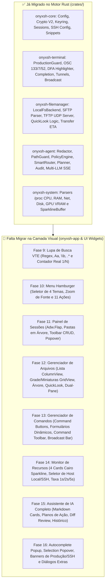

# Plano Estruturado de Migração de UI/UX e Paridade Funcional (Python $\rightarrow$ Rust GTK4/Libadwaita/VTE4)

> **Objetivo:** Mapear 100% das funcionalidades visuais, interativas e de produtividade presentes na versão Python (`src/onyxsh/`) que ainda precisam ser acopladas ou expandidas na interface gráfica nativa em Rust (`crates/onyxsh-*`), garantindo paridade total de recursos.

---

## 1. Diagnóstico do Estado Atual (Motor de Domínio vs. Camada Visual GTK4)

A migração realizada nas **Fases 0 a 8** portou toda a fundação de engenharia e segurança para Rust (66 testes unitários passando em `crates/`), porém a janela gráfica atual em [`crates/onyxsh-app/src/window.rs`](file:///home/vagnarok/OnyxSH/crates/onyxsh-app/src/window.rs) implementa apenas um **shell inicial (MVP)** da interface.

Abaixo está o comparativo exato entre o que **já existe no motor Rust** e o que **falta construir na camada de widgets GTK4/Libadwaita/VTE4**:



---

## 2. Inventário Completo de Funcionalidades Pendentes e Mapeamento Módulo a Módulo

### 🔎 Fase 9 — Barra de Busca Avançada no Terminal (Lupa & Contador de Ocorrências)
Na versão Python, a busca no terminal permite localizar múltiplos textos no buffer do VTE com destaque em tempo real e contagem exata de ocorrências (`1/42`).

| Origem Python | Destino Rust Proposto | Funcionalidades Detalhadas a Implementar |
| :--- | :--- | :--- |
| [`ui/window_ui.py`](file:///home/vagnarok/OnyxSH/src/onyxsh/ui/window_ui.py#L200-L270) (`search_bar`) | `crates/onyxsh-app/src/widgets/search_bar.rs` | • `gtk4::SearchBar` acoplada abaixo da `Adw::HeaderBar` ativada pelo botão de lupa (`edit-find-symbolic`) ou `Ctrl+Shift+F`.<br>• `gtk4::SearchEntry` conectada ao teclado (`Enter` = próximo, `Shift+Enter` = anterior, `Esc` = fechar).<br>• Grupo de botões `.linked`: **`Aa`** (Case Sensitive), **`\b`** (Palavra Inteira / Whole Word) e **`.*`** (Expressão Regular).<br>• Label contador de ocorrências (`search_occurrence_label`: ex. `3 de 18` ou `0/0`). |
| [`terminal/manager.py`](file:///home/vagnarok/OnyxSH/src/onyxsh/terminal/manager.py) & [`window.py`](file:///home/vagnarok/OnyxSH/src/onyxsh/window.py) | `crates/onyxsh-app/src/terminal_search.rs` | • Compilação de `vte4::Regex::for_search(pattern, PCRE2_MULTILINE \| PCRE2_UTF)` aplicando flags `CASELESS` quando `Aa` estiver desativado.<br>• Chamada a `terminal.search_set_regex(Some(&regex), 0)`, `terminal.search_find_next()` e `terminal.search_find_previous()`.<br>• Extração assíncrona/rápida do texto do VTE para calcular o total de ocorrências no buffer e atualizar o índice atual ao navegar com as setas `go-up-symbolic` / `go-down-symbolic`. |

---

### 🍔 Fase 10 — Menu Hamburger Principal, Seletor de Temas e Controle de Fonte
No Python, o botão `open-menu-symbolic` abre um `Gtk.Popover` customizado com seletores visuais de estilo e atalhos para todos os subsistemas.

| Origem Python | Destino Rust Proposto | Funcionalidades Detalhadas a Implementar |
| :--- | :--- | :--- |
| [`ui/menus.py`](file:///home/vagnarok/OnyxSH/src/onyxsh/ui/menus.py#L16-L77) (`ThemeSelectorWidget`) | `crates/onyxsh-app/src/widgets/main_menu.rs` | • Seletor visual horizontal com 4 `gtk4::CheckButton` estilizados via CSS (`.theme-selector`):<br>  1. **Seguir Estilo do Sistema** (`default` / `.follow`)<br>  2. **Estilo Claro** (`light` / `.light`)<br>  3. **Estilo Escuro** (`dark` / `.dark`)<br>  4. **Combinar com Cores do Terminal** (`terminal` / `.terminal` — adapta toda a janela GTK4 para a paleta do VTE ativa). |
| [`ui/menus.py`](file:///home/vagnarok/OnyxSH/src/onyxsh/ui/menus.py#L79-L145) (`FontSizerWidget`) | `crates/onyxsh-app/src/widgets/main_menu.rs` | • `gtk4::CenterBox` com botão `-` (`zoom-out-symbolic`), botão central exibindo `12 pt` (clicar reseta o tamanho padrão) e botão `+` (`zoom-in-symbolic`), atualizando `AppSettings::font` e todos os terminais abertos em tempo real. |
| [`ui/menus.py`](file:///home/vagnarok/OnyxSH/src/onyxsh/ui/menus.py#L147-L320) (`MainApplicationMenu`) | `crates/onyxsh-app/src/widgets/main_menu.rs` | • Lista de itens de menu com rótulos de atalhos alinhados à direita:<br>  - `Nova Janela` (`win.new-window`)<br>  - `Exportar Saída do Terminal...` (`win.export-terminal-buffer` $\rightarrow$ abre diálogo para salvar `.txt`, `.md`, `.html`, `.cast`)<br>  - `Preferências` (`win.preferences`)<br>  - `Cores` (`win.highlight-settings` com ícone `format-text-highlight-symbolic`)<br>  - `Assistente de IA` (`win.configure-ai`)<br>  - `Atalhos de Teclado` (`win.shortcuts`)<br>  - `Importar Sessões SecureCRT` (`win.import-securecrt-sessions`)<br>  - `Gerenciador de Túneis SSH` (`win.show-tunnel-manager`)<br>  - `Iniciar / Parar Servidor TFTP` (`win.toggle-tftp-server` com label dinâmico)<br>  - `Sobre` (`app.about`) e `Sair` (`app.quit`). |

---

### 🖥️ Fase 11 — Painel de Sessões Completo (Árvore de Pastas, Toolbar CRUD, Popover e Busca)
Atualmente a barra lateral em Rust exibe apenas uma lista simples. No projeto Python, o painel de sessões possui gerenciamento hierárquico completo.

| Origem Python | Destino Rust Proposto | Funcionalidades Detalhadas a Implementar |
| :--- | :--- | :--- |
| [`ui/window_ui.py`](file:///home/vagnarok/OnyxSH/src/onyxsh/ui/window_ui.py#L276-L295) & [`ui/sidebar_manager.py`](file:///home/vagnarok/OnyxSH/src/onyxsh/ui/sidebar_manager.py) | `crates/onyxsh-app/src/widgets/session_sidebar.rs` | • Container deslizante (`adw::OverlaySplitView` / `adw::Flap`) com botão `pin-symbolic` que alterna entre **Painel Fixo** e **Modo Popover Flutuante** (`sidebar_popover`).<br>• **Toolbar superior** com 5 botões de ação:<br>  1. `Adicionar Sessão` (`list-add-symbolic`)<br>  2. `Adicionar Pasta` (`folder-new-symbolic`)<br>  3. `Editar Selecionado` (`document-edit-symbolic`)<br>  4. `Salvar Layout Atual` (`document-save-symbolic` $\rightarrow$ salva `state.json`)<br>  5. `Remover Selecionado` (`user-trash-symbolic` `.destructive`). |
| [`sessions/tree.py`](file:///home/vagnarok/OnyxSH/src/onyxsh/sessions/tree.py) & [`sessions/operations.py`](file:///home/vagnarok/OnyxSH/src/onyxsh/sessions/operations.py) | `crates/onyxsh-app/src/widgets/session_tree.rs` | • Renderização em árvore (`gtk4::TreeListModel` + `gtk4::ListView`) agrupando sessões por `SessionFolder` (`folder_path`), além da seção virtual de hosts do `~/.ssh/config`.<br>• Indicador colorido da sessão (`tab_color`), badge de Produção (`PROD`) e indicador de saúde/latência SSH (`🟢 14ms`, `🟡 180ms`, `🔴 Offline`).<br>• **Busca inferior (`sidebar_search_entry`):** filtra sessões e expande pastas automaticamente enquanto o usuário digita. |
| [`ui/widgets/inline_context_menu.py`](file:///home/vagnarok/OnyxSH/src/onyxsh/ui/widgets/inline_context_menu.py) & [`ui/dialogs/session_edit_dialog.py`](file:///home/vagnarok/OnyxSH/src/onyxsh/ui/dialogs/session_edit_dialog.py) | `crates/onyxsh-app/src/dialogs/session_edit.rs` | • Menu de contexto ao clicar com botão direito na sessão/pasta (`Conectar`, `Conectar em Split Horizontal/Vertical`, `Abrir SFTP`, `Duplicar`, `Mover para Pasta`, `Editar`, `Excluir`).<br>• Diálogo completo de criação/edição de Sessão (`SSH`, `Local`, `Telnet`, `Serial`), configuração de chave SSH / senha (integrado ao `KeyringManager`), comando pós-login, X11 forwarding, túneis de porta e flag **Ambiente de Produção**. |

---

### 📁 Fase 12 — Gerenciador de Arquivos Completo (Lista, Miniaturas/Grade, Árvore, Dual-Pane e Quick Look)
O gerenciador de arquivos do projeto Python ([`filemanager/manager.py`](file:///home/vagnarok/OnyxSH/src/onyxsh/filemanager/manager.py)) é um dos módulos mais ricos do OnyxSH (6.350 linhas).

| Origem Python | Destino Rust Proposto | Funcionalidades Detalhadas a Implementar |
| :--- | :--- | :--- |
| [`filemanager/manager.py`](file:///home/vagnarok/OnyxSH/src/onyxsh/filemanager/manager.py) (`_build_ui`, `_set_view_mode`) | `crates/onyxsh-app/src/filemanager_ui/mod.rs` | • **Alternador de Visualização (`gtk4::Stack`)** com 3 modos persistidos nas configurações:<br>  1. **Modo Lista Detalhada (`gtk4::ColumnView`)**: Colunas ordenáveis por *Nome*, *Tamanho*, *Permissões (`rwxr-xr-x`)*, *Proprietário (`uid:gid`)* e *Data de Modificação*.<br>  2. **Modo Grade / Miniaturas (`gtk4::GridView`)**: Cards visuais com geração assíncrona de **miniaturas reais (`gdk_pixbuf::Pixbuf`)** para imagens (`.png`, `.jpg`, `.svg`, `.webp`) e ícones MIME grandes para pastas/arquivos.<br>  3. **Modo Árvore (`gtk4::TreeListModel` + `gtk4::ListView`)**: Expansão inline de subpastas sem sair do diretório raiz. |
| [`filemanager/local_pane.py`](file:///home/vagnarok/OnyxSH/src/onyxsh/filemanager/local_pane.py) & [`filemanager/dual_pane.py`](file:///home/vagnarok/OnyxSH/src/onyxsh/filemanager/dual_pane.py) | `crates/onyxsh-app/src/filemanager_ui/dual_pane.rs` | • **Barra de Navegação Completa:** Botões `Home`, `Subir Nível`, `Atualizar`, **Trilha de Breadcrumbs clicável** (botões por segmento de caminho + edição direta do path), toggle de arquivos ocultos, busca local/recursiva (`MAX_RECURSIVE_RESULTS = 1000`).<br>• **Modo Dual-Pane (`Local <-> Remoto/SFTP`):** Barra central `DualPaneTransferBar` com botões de transferência rápida (`--> Enviar`, `<-- Baixar`, `Sincronizar / Comparar Diff Remoto`).<br>• Sincronização automática de diretório com o terminal ativo via **OSC 7** (`osc7.rs`). |
| [`filemanager/quick_look.py`](file:///home/vagnarok/OnyxSH/src/onyxsh/filemanager/quick_look.py) & [`filemanager/transfer_dialog.py`](file:///home/vagnarok/OnyxSH/src/onyxsh/filemanager/transfer_dialog.py) | `crates/onyxsh-app/src/filemanager_ui/quick_look_window.rs` | • **Janela Quick Look (Tecla `Espaço`):** Exibe imagem redimensionável, texto colorido com numeração de linhas ou resumo de arquivo compactado/diretório, com botões `< Anterior` e `Próximo >`.<br>• **Menu de Contexto de Arquivos:** `Abrir`, `Editar Remotamente` (monitorando alterações em `remote_edit_tmp` e ativando o botão `user-trash-symbolic` na HeaderBar), `Renomear`, `Alterar Permissões (chmod)`, `Calcular Checksum SHA-256`, `Compactar/Extrair`, `Copiar Caminho`.<br>• **Diálogo de Fila de Transferências (`TransferManagerDialog`):** Barras de progresso, velocidade em MB/s e ETA (`transfer.rs`). |

---

### ⚡ Fase 13 — Gerenciador de Comandos, Formulários Dinâmicos, Command Toolbar e Broadcast
Substitui a digitação repetitiva por botões parametrizados, barra de ferramentas fixável e execução simultânea em múltiplos terminais.

| Origem Python | Destino Rust Proposto | Funcionalidades Detalhadas a Implementar |
| :--- | :--- | :--- |
| [`data/command_manager_models.py`](file:///home/vagnarok/OnyxSH/src/onyxsh/data/command_manager_models.py) | `crates/onyxsh-core/src/command_manager.rs` | • Estruturas `CommandButton`, `CommandFormField`, `FieldType` (`Text`, `Password`, `TextArea`, `Switch`, `Dropdown`, `Number`, `Slider`, `FilePath`, `DirectoryPath`, `DateTime`, `Color`, `Radio`, `MultiSelect`), `ExecutionMode` (`InsertOnly`, `InsertAndExecute`, `ShowForm`) e persistência compatível com `~/.config/onyxsh/command_buttons.json`. |
| [`ui/dialogs/command_manager_dialog.py`](file:///home/vagnarok/OnyxSH/src/onyxsh/ui/dialogs/command_manager_dialog.py) & [`ui/widgets/form_widget_builder.py`](file:///home/vagnarok/OnyxSH/src/onyxsh/ui/widgets/form_widget_builder.py) | `crates/onyxsh-app/src/dialogs/command_manager.rs` | • **Diálogo do Gerenciador de Comandos** (aberto pelo botão `utilities-terminal-symbolic` na HeaderBar): Grade/lista de comandos categorizados, busca, filtro por tags, botão de fixar/desafixar na toolbar, criação/edição de comandos.<br>• **`CommandFormDialog`:** Gera dinamicamente os campos GTK4 a partir de `CommandFormField`, exibe preview do comando Bash em tempo real com syntax highlighting e permite executar no terminal atual ou **Enviar para Todos (`Send to All`)**. |
| [`ui/window_ui.py`](file:///home/vagnarok/OnyxSH/src/onyxsh/ui/window_ui.py#L208-L220) & [`L526-L687`](file:///home/vagnarok/OnyxSH/src/onyxsh/ui/window_ui.py#L526-L687) | `crates/onyxsh-app/src/widgets/command_toolbar.rs` | • **Command Toolbar Fixada:** Barra horizontal abaixo da HeaderBar com os comandos favoritos fixados e menu de contexto (`Apenas Ícone`, `Apenas Texto`, `Ícone e Texto`, `Desafixar`).<br>• **Broadcast Bar (`broadcast_bar`):** Barra de entrada rápida para enviar comandos simultaneamente a múltiplos terminais divididos/abas, protegida pelo [`BroadcastRouter`](file:///home/vagnarok/OnyxSH/crates/onyxsh-terminal/src/broadcast.rs#L35-L96). |

---

### 📈 Fase 14 — Monitor de Recursos com Gráficos Sparkline Cairo e Suporte Remoto SSH
No projeto Python, o botão `computer-symbolic` na HeaderBar abre um painel/diálogo de telemetria gráfica em tempo real.

| Origem Python | Destino Rust Proposto | Funcionalidades Detalhadas a Implementar |
| :--- | :--- | :--- |
| [`ui/widgets/sparkline.py`](file:///home/vagnarok/OnyxSH/src/onyxsh/ui/widgets/sparkline.py) | `crates/onyxsh-app/src/widgets/sparkline_canvas.rs` | • Widget `gtk4::DrawingArea` utilizando `cairo::Context` e os pontos normalizados de [`SparklineBuffer::to_cairo_points`](file:///home/vagnarok/OnyxSH/crates/onyxsh-system/src/lib.rs#L219-L236) para desenhar curvas suaves com gradiente translúcido e mudança automática de cor conforme limiares de alerta (`<70%` azul/verde, `70-90%` amarelo, `>90%` vermelho). |
| [`ui/widgets/resource_dashboard.py`](file:///home/vagnarok/OnyxSH/src/onyxsh/ui/widgets/resource_dashboard.py) & [`ui/dialogs/resource_dashboard_dialog.py`](file:///home/vagnarok/OnyxSH/src/onyxsh/ui/dialogs/resource_dashboard_dialog.py) | `crates/onyxsh-app/src/dialogs/resource_dashboard.rs` | • **Toolbar de Controle:** Dropdown seletor de Host (`Local (Este Computador)` + sessões SSH ativas coletando métricas remotas), badge `🟢 Ativo / ⏸️ Pausado`, seletor de taxa (`1s`, `2s`, `5s`) e botão Pausar.<br>• **Suspensão Zero-Overhead:** Conecta sinais `map` e `unmap` para pausar o coletor imediatamente quando a janela é fechada.<br>• **4 Cards de Métricas:**<br>  1. **Processador (CPU):** Percentual total, modelo da CPU, contagem de núcleos e gráfico Sparkline.<br>  2. **Memória (RAM + Swap):** Uso em GB/MB, `gtk4::LevelBar` para RAM e Swap, e gráfico Sparkline.<br>  3. **Disco (I/O & Partições):** Taxa de leitura/escrita (`/proc/diskstats`) e uso da partição raiz (`/`).<br>  4. **Rede (RX / TX) & GPU VRAM:** Taxas de download/upload em KB/s ou MB/s (`/proc/net/dev`) + uso de VRAM (`gpu_disk.rs`). |

---

### 🤖 Fase 15 — Painel de Assistente por IA Zero-Trust Completo
Evolução do painel lateral de IA para suportar todo o fluxo interativo de planos de ação, streaming SSE, histórico persistente e revisão de diffs.

| Origem Python | Destino Rust Proposto | Funcionalidades Detalhadas a Implementar |
| :--- | :--- | :--- |
| [`ui/widgets/ai_chat_panel.py`](file:///home/vagnarok/OnyxSH/src/onyxsh/ui/widgets/ai_chat_panel.py) | `crates/onyxsh-app/src/ai_ui/chat_panel.rs` | • **Layout Redimensionável (`gtk4::Paned`):** Painel inferior/lateral com cabeçalho contendo seletor de perfil do [`SmartRouter`](file:///home/vagnarok/OnyxSH/crates/onyxsh-agent/src/router.rs#L104) (`Auto`, `Rápido`, `Avançado`, `Segurança`), indicador de modo Offline, botão de anexar arquivo (validado pelo [`PathGuard`](file:///home/vagnarok/OnyxSH/crates/onyxsh-agent/src/path_guard.rs#L22)) e botão de histórico.<br>• **Renderizador de Mensagens & Blocos de Código:** Formatação de Markdown em widgets GTK4 nativos; cada bloco ````bash` exibe botões **[Inserir no Terminal]**, **[Executar]** (passando pelo [`ProductionGuard`](file:///home/vagnarok/OnyxSH/crates/onyxsh-terminal/src/production_guard.rs#L172)) e **[Copiar]**. |
| [`agent/orchestrator.py`](file:///home/vagnarok/OnyxSH/src/onyxsh/agent/orchestrator.py) & [`ui/dialogs/diff_review_dialog.py`](file:///home/vagnarok/OnyxSH/src/onyxsh/ui/dialogs/diff_review_dialog.py) | `crates/onyxsh-app/src/ai_ui/plan_runner.rs` | • **Cartões de Plano de Ação (`ActionPlan`):** Exibe os passos gerados pelo [`planner.rs`](file:///home/vagnarok/OnyxSH/crates/onyxsh-agent/src/planner.rs) com badges de risco (`LOW`, `MEDIUM`, `HIGH`, `CRITICAL`), permitindo aprovar passo a passo ou executar lote seguro.<br>• **`DiffReviewDialog`:** Visualizador lado a lado / unificado antes de permitir que o agente modifique arquivos locais, criando backup automático no [`AuditLogger`](file:///home/vagnarok/OnyxSH/crates/onyxsh-agent/src/audit.rs#L36) com botão de **Rollback em 1 clique**.<br>• **Verificação Pós-Execução (`verifier.rs`):** Executa checagens automáticas (ex: `systemctl is-active`) após o passo e exibe badge `✅ Verificado` ou `❌ Falhou`. |
| [`ui/widgets/conversation_history.py`](file:///home/vagnarok/OnyxSH/src/onyxsh/ui/widgets/conversation_history.py) & [`data/ai_history_manager.py`](file:///home/vagnarok/OnyxSH/src/onyxsh/data/ai_history_manager.py) | `crates/onyxsh-app/src/ai_ui/history.rs` | • Persistência de sessões de chat em `~/.config/onyxsh/ai_history.json` com busca, retomada de conversa, exportação para Markdown e exclusão. |

---

### 🛡️ Fase 16 — Emulação Avançada no Terminal, Popovers Contextuais e Diálogos de Sistema
Integra os motores do `onyxsh-terminal` diretamente nos eventos de teclado/mouse do `vte4::Terminal`.

| Origem Python | Destino Rust Proposto | Funcionalidades Detalhadas a Implementar |
| :--- | :--- | :--- |
| [`terminal/completion/popup.py`](file:///home/vagnarok/OnyxSH/src/onyxsh/terminal/completion/popup.py) | `crates/onyxsh-app/src/widgets/completion_popup.rs` | • **`AutocompletePopup` (`gtk4::Popover`):** Ao digitar no terminal, consulta o [`CompletionEngine`](file:///home/vagnarok/OnyxSH/crates/onyxsh-terminal/src/completion.rs#L140) (`git`, `docker`, `systemctl`, `apt`, `flatpak`, `cargo`, histórico) e posiciona o popup sob o cursor do VTE com navegação por `Tab` / `Setas`. |
| [`ui/widgets/selection_popover.py`](file:///home/vagnarok/OnyxSH/src/onyxsh/ui/widgets/selection_popover.py) | `crates/onyxsh-app/src/widgets/selection_popover.rs` | • **`SelectionPopover`:** Ao selecionar texto no terminal com o mouse, exibe barra flutuante rápida: `Copiar`, `Explicar com IA`, `Buscar na Web`, `Criar Snippet`. |
| [`ui/widgets/production_banner.py`](file:///home/vagnarok/OnyxSH/src/onyxsh/ui/widgets/production_banner.py) & [`ui/dialogs/production_confirm_dialog.py`](file:///home/vagnarok/OnyxSH/src/onyxsh/ui/dialogs/production_confirm_dialog.py) | `crates/onyxsh-app/src/widgets/banners.rs` | • **`ProductionBanner`:** Faixa de alerta vermelha/âmbar no topo de abas marcadas com `is_production = true`.<br>• **`ProductionConfirmDialog`:** Intercepta `Enter` no terminal quando [`ProductionGuard::evaluate_command`](file:///home/vagnarok/OnyxSH/crates/onyxsh-terminal/src/production_guard.rs#L280) detecta um comando destrutivo (ex: `rm -rf`, `DROP TABLE`, `mkfs`), exigindo confirmação explícita antes de enviar ao PTY.<br>• **`SSHErrorBanner` (`ssh_error_banner.py`):** Faixa de reconexão rápida quando uma sessão SSH cai. |
| [`ui/dialogs/*`](file:///home/vagnarok/OnyxSH/src/onyxsh/ui/dialogs/) | `crates/onyxsh-app/src/dialogs/` | • `CommandPaletteDialog` (`Ctrl+Shift+P` — busca unificada de ações, sessões e comandos).<br>• `HighlightDialog` (configuração de regras de cores Regex do `highlighter.rs`).<br>• `CommandHistoryDialog` (`command_history_manager.py`).<br>• `GitCommitDialog` / `GitAssistant` (`terminal/git_assistant.py`).<br>• `AuditLogDialog`, `ChecksumDialog` e `DiagnosticsDialog`. |

---

## 3. Ordem Recomendada de Execução (Roadmap Incremental)

Para que você possa testar visualmente cada evolução no binário nativo [`target/release/onyxsh`](file:///home/vagnarok/OnyxSH/target/release/onyxsh) sem quebrar o que já funciona:

1. **Etapa 1 (Fases 9 e 10):** Implementar a **Lupa de Busca no Terminal** (com `Aa`, `\b`, `.*` e contador `1/N`) + o **Menu Hamburger Completo** (Seletor de 4 Temas, Zoom de Fonte e ações).
2. **Etapa 2 (Fase 11):** Implementar o **Painel de Sessões Completo** (Toolbar CRUD de Sessões/Pastas, Árvore hierárquica, Busca inferior, Modo Fixo/Popover e Diálogo de Edição de Sessão).
3. **Etapa 3 (Fase 12):** Expandir o **Gerenciador de Arquivos** (Alternância Lista `ColumnView` / Miniaturas `GridView` / Árvore, Breadcrumbs, Quick Look na tecla Espaço e Dual-Pane com barra de transferência).
4. **Etapa 4 (Fases 13 e 14):** Implementar o **Gerenciador de Comandos + Command Toolbar + Broadcast Bar** e o **Monitor de Recursos com Sparklines Cairo**.
5. **Etapa 5 (Fases 15 e 16):** Expandir o **Painel de Assistente por IA** (Cards Markdown, Planos de Ação, Diff Review) + **Autocomplete Popup, Selection Popover e Banners de Produção**.
